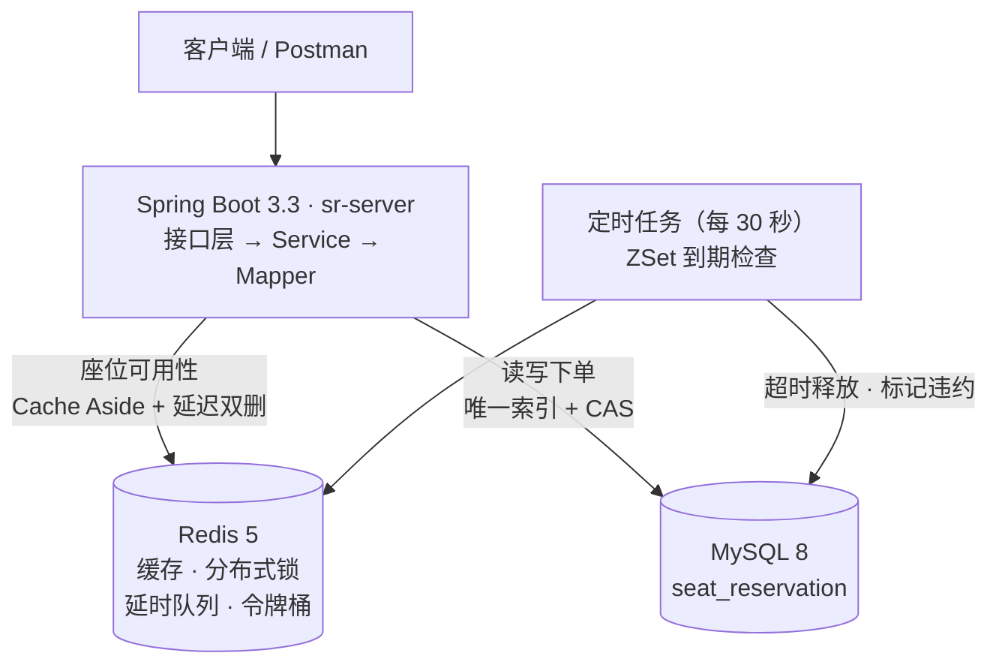

# campus-seat-reservation · 高校自习室座位预约平台

> 一个 Java 后端项目。全项目的核心命题只有一句话：
> **同一座位、同一天、同一时段，绝不能被两个人同时占走。**

---

## 为什么做这个

学校的自习室抢座很痛苦：到店发现没空位，或者座位被人长期占着不用。

现有的人工方式解决不了两件事：

1. **同一时段被重复占用** —— 两个人同时点同一个座位，系统必须保证只有一个成功
2. **约了不来** —— 座位被僵尸占用，必须能自动回收

这个项目就是围绕这两个问题设计的。

## 环境要求

| 依赖 | 版本 | 说明 |
|---|---|---|
| JDK | **17** | 项目锁定 17（`java.version=17`）。用 21 编译会报「无效的目标发行版」 |
| Maven | 3.9+ | 也可以直接用仓库自带的 `./mvnw`，**无需本机安装 Maven** |
| MySQL | 8.0+ | 需要 `utf8mb4` 字符集 |
| Redis | 6.0+ | M1 阶段仅做连接配置；从 M2 的登录态开始成为必需 |
| Git | 任意 | |

## 技术栈

| 分类 | 选型 |
|---|---|
| 语言 / 运行时 | Java 17 |
| 框架 | Spring Boot 3.3.13 |
| 持久层 | MyBatis-Plus 3.5.7 |
| 数据库 | MySQL 8 |
| 缓存 / 分布式 | Redis |
| 构建 | Maven（三模块） |
| 部署 | Docker Compose + Nginx |

**明确不引入**：Spring Cloud / Nacos、消息队列、Elasticsearch、分库分表、分布式事务框架。
理由：这些技术解决的是"多团队、多实例、超大规模"的问题，这个项目一个都没有。
**把一件事做深，比堆十个名词有用。**

## 整体结构



## 功能清单

| 端 | 能做什么 |
|---|---|
| 学生端 | 注册登录 / 按自习室 + 日期 + 时段查空座 / 预约下单（一次性令牌防重、令牌桶限流）/ 我的预约 / 取消 / 签到 / 热门座位排行 |
| 管理端 | 自习室与座位增删改查 / 预约分页查询（按用户、日期、状态、自习室筛选）/ 标记违约 / 人工释放 / 上座率报表 / 预约趋势报表 |
| 工程能力 | 统一返回体与错误码、JWT + Redis 白名单登录态、RBAC 权限点鉴权、全局异常处理、`docker compose up` 一键起全栈 |

## 工程结构

```
campus-seat-reservation/           父工程：统一版本 + 模块聚合（packaging=pom）
├── docs/
│   ├── walkthrough.md             30 分钟讲清这个项目（问题 → 方案 → 取舍 → 实测 → 局限）
│   ├── qa.md                      常见追问与回答，每个都讲到边界和失败场景
│   ├── M2-acceptance.md           M2 核心闭环验收记录（含并发实测数据）
│   ├── M3-acceptance.md           M3 技术亮点验收记录（九条亮点的「加之前 vs 加之后」）
│   └── M4-loadtest.md             压测环境、命令、结果与瓶颈分析
├── postman/
│   └── CampusBook.postman_collection.json  接口集合，导入后可跑通完整闭环
├── sql/
│   ├── 01_init.sql                建库
│   ├── 02_schema.sql              建表（设计说明写在表定义旁边）
│   └── 03_verify_unique_index.sql 唯一索引防重复预约的验收脚本
├── sr-common/                     通用能力层（与业务无关，可被任意模块依赖）
│   └── com.sr.common
│       ├── result/                Result / ResultCode / PageResult
│       └── exception/             BizException
├── sr-pojo/                       领域模型层（只放数据类，不含逻辑）
│   └── com.sr.pojo
│       ├── entity/  dto/  vo/  enums/
└── sr-server/                     业务与接入层（唯一可启动模块）
    └── com.sr
        ├── controller/           接口层：只做参数校验 + 调用 Service
        ├── service/ impl/        业务逻辑与事务边界
        ├── mapper/               MyBatis-Plus Mapper
        ├── redis/                缓存 / 分布式锁 / 延时队列 / 限流
        ├── task/                 定时任务
        ├── config/               配置
        ├── interceptor/          JWT 鉴权
        └── exception/            全局异常处理
```

依赖方向：`sr-server → sr-pojo → sr-common`，**单向，禁止反向**。

**模块划分依据是「复用边界」，不是「技术分层」。** 分层放在包这一层做（controller / service / mapper），模块层面只拆出真正的复用单元。

## 数据库表一览

| 表 | 职责 | 关键设计 |
|---|---|---|
| `sys_user` | 用户（学生 / 管理员） | `uk_username`。「删除用户」用 `status` 表达，不用逻辑删除 |
| `study_room` | 自习室 | `uk_room_name(room_name, deleted)`。`capacity` 只是规划上限，权威座位数在 `seat` 表 |
| `seat` | 座位 | `uk_room_seat(room_id, seat_no, deleted)`。**`status` 里不含"占用"语义** |
| `time_slot` | 时段定义（上午 / 下午 / 晚上） | 仅 3 行，`TIME` 类型。它的存在是唯一索引能生效的前提 |
| `reservation` | 预约单 | `uk_seat_date_slot(seat_id, reserve_date, slot_id, occupy_flag)` ← **防超卖第一层** |

## 快速开始

```bash
# 0. 拉代码
git clone https://github.com/zmw6660609/campus-seat-reservation.git
cd campus-seat-reservation

# 1. 建库建表（需要本机 MySQL 8 已启动）
mysql -uroot -p < sql/01_init.sql
mysql -uroot -p seat_reservation < sql/02_schema.sql

# 2. 本地配置（application-dev.yml 不进版本库，从示例复制一份）
cp sr-server/src/main/resources/application-dev.yml.example \
   sr-server/src/main/resources/application-dev.yml
# 然后编辑它，填上你自己的 MySQL 密码与 Redis 地址

# 3. 编译（两种方式任选其一）
./mvnw clean compile      # 用仓库自带的 Maven Wrapper，无需本机装 Maven
mvn clean compile         # 或使用本机 Maven 3.9+
```

Windows 下把 `./mvnw` 换成 `mvnw.cmd`。

```bash
# 4. 启动
./mvnw -pl sr-server spring-boot:run

# 5. 自检
curl http://localhost:8080/health
```

### 另一种方式：Docker Compose 一键起全栈

本机不装 MySQL、Redis、JDK 也能跑，一条命令把三个服务全拉起来：

```bash
cp .env.example .env          # 填 MySQL root 密码和 JWT 密钥
docker compose up -d --build
curl http://localhost:8080/health
```

| 服务 | 地址 | 说明 |
|---|---|---|
| 应用 | `localhost:8080` | 多阶段构建：maven 镜像编译 → jre 镜像运行 |
| MySQL | `localhost:13306` | 故意错开 3306，避免和本机已装的 MySQL 抢端口 |
| Redis | `localhost:16379` | 开了 AOF，重启不丢延时队列和热榜 |

三个容易踩的点：

- **改了 `sql/*.sql` 必须 `docker compose down -v`** —— 初始化脚本只在数据卷为空时执行一次，
  改完不重建数据卷，你会以为改动没生效。
- **要求 Docker Compose V2**（`docker compose`，不是 `docker-compose`）。配置里用了
  `depends_on: condition: service_healthy`，V1 不支持，会在 MySQL 还没能连的时候就把应用拉起来。
- 容器内访问 Maven Central 会超时，仓库里带了 `maven-settings.xml`（阿里云镜像），
  Dockerfile 已经用 `-s` 指过去了，不用额外配置。

### 排错：`JAVA_HOME is not defined correctly`

`mvnw` 自己会下载 Maven，但**不会自己找 JDK**。如果机器上装了 JDK 却没配 `JAVA_HOME`
（IDEA 里能跑、命令行里报这个错，就是这个原因），先把它指到 JDK 17：

```bash
# Git Bash / macOS / Linux
export JAVA_HOME=/path/to/jdk-17

# Windows CMD
set JAVA_HOME=D:\path\to\jdk-17
```

必须是 **JDK 17**。项目三处锁定了 17（`java.version`、IDEA 的 Project SDK、Language level），
用 21 编译会报「无效的目标发行版: 17」。

## 开发进度

- [x] **M1 骨架跑通** —— 三模块 Maven 工程、统一返回体、全局异常、Redis 配置、环境分离
- [x] **M2 核心闭环** —— 表设计 / 登录注册 / 自习室与座位管理 / 查空座 / 预约下单 / 取消 / 签到
- [x] **M3 技术亮点** —— 防超卖三层递进（唯一索引 → 乐观锁 → 手写 Redis 锁 → Redisson）、
      ZSet 延时队列超时释放、缓存与一致性（穿透 / 击穿 / 雪崩 + 延迟双删）、热门座位排行、
      令牌桶限流、幂等防重复提交
      → 每条都有「加之前 vs 加之后」的实测数据，见 [`docs/M3-acceptance.md`](docs/M3-acceptance.md)
- [x] **M4 工程化** —— RBAC 权限（3 表 + 5 个权限点 + 拦截器）、管理端预约查询与人工处理、
      统计报表（上座率 / 预约趋势）、单元测试（10 个用例，纯 Mockito，不依赖 MySQL / Redis）、
      Docker Compose 一键起全栈（MySQL + Redis + 应用）
- [x] **M4 压测** —— 四个场景实测：查空座约 4.7k QPS（缓存命中）、
      下单 112 QPS 且瓶颈被令牌桶锁死、10 并发抢同一座位 5407 次只成功 1 单
      → 环境、命令与瓶颈分析见 [`docs/M4-loadtest.md`](docs/M4-loadtest.md)
- [ ] **M4 上线** —— 部署到云服务器

## 设计要点

### 防超卖第一层：数据库唯一索引

```sql
UNIQUE KEY uk_seat_date_slot (seat_id, reserve_date, slot_id, occupy_flag)
```

`occupy_flag` 只有两个取值：`1`（占用中）和 `NULL`（已释放）。

利用 **MySQL 唯一索引对 NULL 不生效** 的特性：只有"占用中"的记录才参与唯一性约束；
取消 / 完成 / 超时后置为 `NULL`，座位立刻可以被重新预约。
如果写成 `1` 和 `0` 两个值，唯一索引就变成"同一座位同一时段只能有一条取消记录"，第二次取消会写不进去。

配套的另一个前提是**时段必须固定**：预约单存的是 `reserve_date` + `slot_id`，而不是自由起止时间。
因为 `9:00-11:00` 和 `10:00-12:00` 明明冲突，两列的值却完全不同，唯一索引拦不住"重叠"。
详见 [`sql/02_schema.sql`](sql/02_schema.sql) 的注释。

### 防超卖的三层递进

唯一索引管不了"查询信用分 → 检查冲突 → 扣减 → 写单"这一串多步操作之间的缝隙，
也表达不了"每人每时段最多 1 个座"这种**数量约束**。所以后面依次加了两层：

| 层 | 手段 | 负责挡住 | 挡不住 |
|---|---|---|---|
| 一 | `uk_seat_date_slot` 唯一索引 | 同一座位同一时段的重复写入 | 数量约束；多步操作之间的缝隙 |
| 二 | `sys_user.version` 乐观锁（CAS + 重试） | 同一用户的并发修改 | 跨进程；CAS 目标是整行用户，同用户并发不同时段会假冲突 |
| 三 | Redis 分布式锁（先手写、后换 Redisson） | 跨实例的并发抢占 | 锁不是数据正确性的最终保证 |

三层是**互补而不是替代**：唯一索引是正确性的底线，锁把并发收敛到可控范围，
乐观锁挡住锁之外的单机并发。三层同时在场时，任一层被绕过，数据仍然是对的；
被拦下的请求也会拿到**具体原因**（`1001` 座位已被预约 / `1015` 你已约过该时段 / `1016` 操作冲突请重试），
而不是含糊的"下单失败"。

M3 另外解决了三件事：**超时未签到自动释放座位**（ZSet 延时队列 + Lua 原子取删）、
**缓存与数据库的最终一致**（Cache Aside + 延迟双删）、
**接口层的滥用防护**（令牌桶限流 + 服务端签发的一次性令牌幂等）。

设计与实测数据见 [`docs/M3-acceptance.md`](docs/M3-acceptance.md)。

## 文档

| 文件 | 内容 |
|---|---|
| [`docs/walkthrough.md`](docs/walkthrough.md) | 30 分钟讲清这个项目：问题 → 方案 → 取舍 → 实测 → 局限，附现场白板演练步骤 |
| [`docs/qa.md`](docs/qa.md) | 15 个常见追问的回答，每个都落在"什么时候不成立" |
| [`docs/M2-acceptance.md`](docs/M2-acceptance.md) | M2 核心闭环验收记录 |
| [`docs/M3-acceptance.md`](docs/M3-acceptance.md) | M3 九条亮点的「加之前 vs 加之后」实测 |
| [`docs/M4-loadtest.md`](docs/M4-loadtest.md) | 压测环境、复现命令、四组结果与瓶颈分析 |

## License

[MIT](LICENSE)
